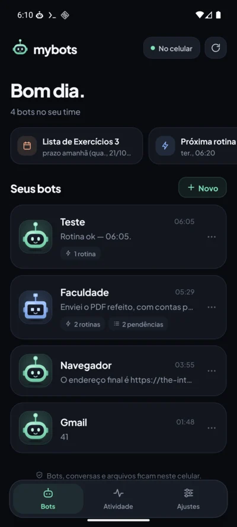
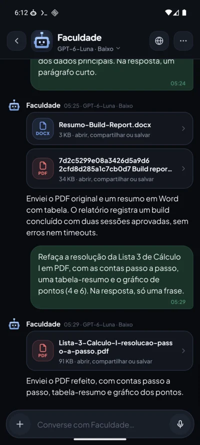
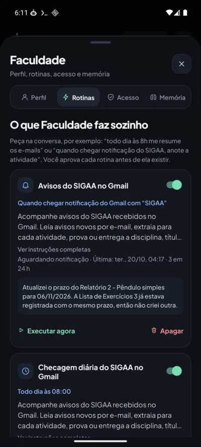
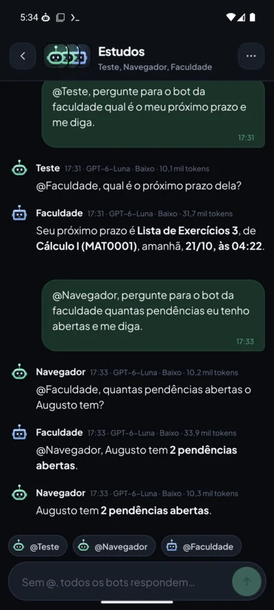
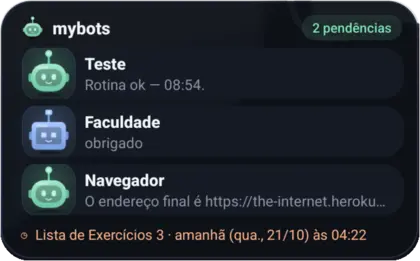
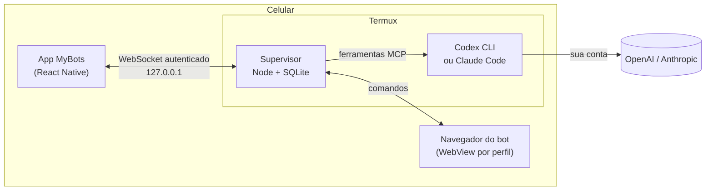

<div align="center">


# MyBots

**Seu pequeno time de bots pessoais, rodando no próprio celular.**

Crie bots com personalidade, dê a cada um uma função, como faculdade, e-mails ou lembretes, e decida o que cada um pode fazer.
Eles conversam, navegam, leem e criam arquivos, seguem rotinas e avisam você, mesmo com a tela apagada.


<br />

&nbsp;
&nbsp;
&nbsp;


<br /><br />



</div>

---

## O que ele faz

| | |
|---|---|
| 🤖 **Bots com cara e jeito próprios** | Nome, personalidade, aparência animada (Órbita, Pixel, Felino, Faísca), modelo e nível de raciocínio por bot. |
| 💬 **Conversa de verdade** | Fila de mensagens enquanto o bot trabalha, ditado por voz, anexos (texto, imagem, PDF, Word, Excel, PowerPoint), tabelas, gráficos e fórmulas na resposta. |
| 📤 **Compartilhar com o bot** | De qualquer app, em "Compartilhar → MyBots", ou direto no bot pelo Direct Share do Android. Links, textos e até 5 arquivos chegam ao campo de mensagem para você revisar antes de enviar. |
| 🌐 **Navegador de cada bot** | Uma WebView com perfil isolado por bot. Você vê a página ao vivo, toca em **Assumir** para fazer um login e devolve o controle. Senhas nunca vão ao modelo. |
| 📄 **Arquivos de ida e volta** | O bot baixa anexos de sites (com o login daquele navegador), lê e devolve PDF, Word ou planilha prontos, com **Abrir**, **Compartilhar** e **Salvar em Downloads**. Também entrega um arquivo num site, como um trabalho no SIGAA, sempre com a sua aprovação. |
| ⏰ **Rotinas e pendências** | Por horário ou quando chega uma notificação ("e-mail do SIGAA"). Prazos viram pendências sem duplicar, e o aviso de véspera chega como notificação do MyBots. |
| 🌙 **Funciona com a tela apagada** | Serviço em primeiro plano, alarmes exatos que atravessam o Doze e reinício automático do supervisor quando o Android o mata. |
| 👥 **Salas com vários bots** | Junte bots numa conversa: sem @ todos respondem, com @Nome só quem você chamar. Um bot pode perguntar a outro com @ (até 3 rodadas), cada um com as próprias permissões e sem ver a memória dos outros. |
| 🔑 **Senhas salvas** | O bot entra sozinho nos sites com a senha que você salvou; ela fica só no celular, só vale no site certo e a IA nunca a vê. |
| 🪄 **Widget animado** | Na tela inicial, os bots respiram, piscam, olham em volta enquanto trabalham e acendem a antena quando esperam você, com a última mensagem e o próximo prazo. |
| 📊 **Uso e limites** | Tokens de cada bot e de cada resposta, e quanto do limite da sua assinatura (5 horas e semana) já foi usado. |
| 🔄 **Atualiza sozinho** | O app avisa quando sai uma versão nova, baixa, confere a assinatura e instala, sem precisar de cabo ou de link. |
| 🛡️ **Você no controle** | Três níveis de acesso por bot (Pouco, Médio, Total), cartões de aprovação para ações de escrita e permissões que um bot nunca herda de outro. |

## Como funciona



- O **app** é a interface: conversas, perfis, aprovações, atividade, arquivos e o navegador ao vivo.
- O **supervisor** roda no Termux e guarda tudo num SQLite no próprio celular: fila de tarefas, rotinas, pendências, memórias e permissões. Ele expõe as ferramentas aos modelos por MCP e decide o que precisa de aprovação.
- Os modelos usam o **Codex** (`pkg install codex`) ou o **Claude Code**, já conectados à sua conta. O MyBots não lê nem copia as credenciais deles.

## Instalação

1. Baixe o APK mais novo em **[Releases](../../releases/latest)** e instale. Depois disso, o próprio app avisa quando sair uma versão nova e se atualiza sozinho.
2. Instale o **Termux** e o **Termux:API** (da mesma fonte, F-Droid ou GitHub).
3. No Termux, permita apps externos:
   ```bash
   echo "allow-external-apps=true" >> ~/.termux/termux.properties && termux-reload-settings
   pkg install codex && codex login
   ```
4. Abra o MyBots, escolha **Só no celular** e conceda **Executar comandos no Termux**. Na primeira vez, o app instala e testa o supervisor sozinho.

> Guias detalhados: [configurar o celular](docs/configurar-celular.md) · [Claude no Termux](docs/claude-termux.md) · [conectar o Gmail](docs/conectar-gmail.md)

## Desenvolvimento

```bash
npm ci --prefix supervisor          # dependências do supervisor
npm install --prefix mobile         # dependências do app
npm test                            # testes (Codex e Claude reais contra API simulada)
scripts/build-apk.sh --offline      # APK ARM64 para o celular
```

Para testar num emulador com Termux e o supervisor de verdade, veja [scripts/emulator/README.md](scripts/emulator/README.md).

| Documento | Conteúdo |
|---|---|
| [docs/PLANO-DESENVOLVIMENTO.md](docs/PLANO-DESENVOLVIMENTO.md) | Etapas, regras de teste e de entrega |
| [docs/progresso.md](docs/progresso.md) | Histórico de cada versão e o que foi validado |
| [docs/supervisor.md](docs/supervisor.md) | Protocolo, recuperação e dados do supervisor |
| [docs/seguranca.md](docs/seguranca.md) | Modelo de segurança e permissões |
| [docs/desenvolvimento.md](docs/desenvolvimento.md) | Modo celular + computador (Expo Go) e notas técnicas |

## Privacidade

Bots, conversas, arquivos e rotinas ficam **no seu celular**. Só a mensagem de cada turno vai ao provedor do modelo que você escolheu. O conteúdo de páginas e arquivos chega aos bots marcado como dado externo, nunca como instrução.

<div align="center">
<sub>Feito em português, para uso pessoal.</sub>
</div>
