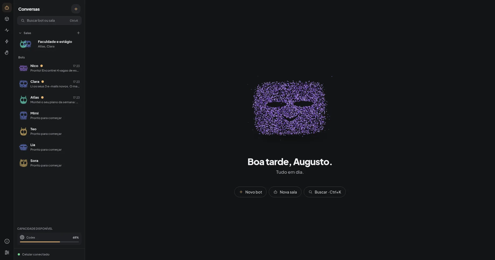
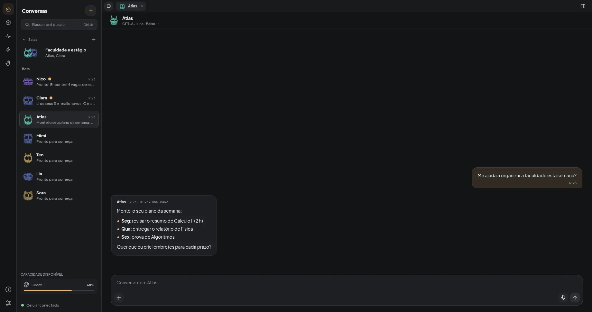
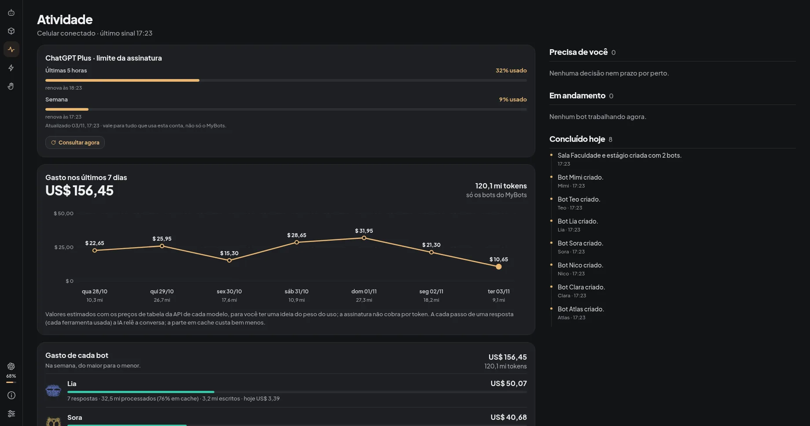
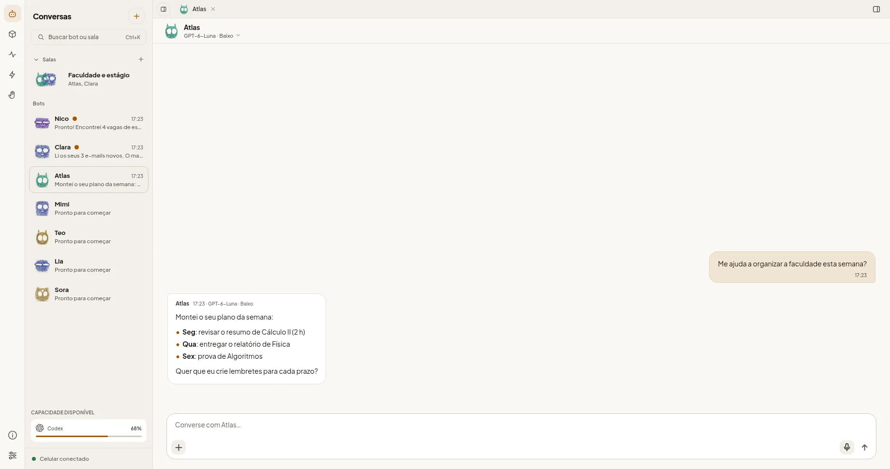
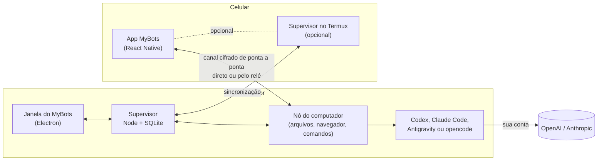

<div align="center">


# MyBots

**Seu pequeno time de bots pessoais, no computador e no celular.**

Crie bots com personalidade, dê a cada um uma função, como faculdade, e-mails ou lembretes, e escolha qual conta Google ele usa. Eles conversam, navegam, leem e criam arquivos, seguem rotinas e avisam você. Instale no **computador** (Linux, Windows ou macOS) e no **celular Android**, conecte os dois e pronto: os bots, as conversas e as rotinas ficam iguais nos dois, e cada lado continua funcionando sozinho. O Termux, no celular, é opcional.


**Últimas versões:**
[](https://github.com/AugustodoBRT/Mybots/releases/latest)
[](https://github.com/AugustodoBRT/Mybots/releases/tag/pc-latest)
[](https://github.com/AugustodoBRT/Mybots/releases/tag/pc-latest)
[](https://github.com/AugustodoBRT/Mybots/releases/tag/pc-latest)

| Sistema | Baixar | Atualização |
|---|---|---|
| 📱 **Android** | [APK na Release mais recente](https://github.com/AugustodoBRT/Mybots/releases/latest) | o app avisa e atualiza sozinho |
| 🐧 **Linux** | [AppImage ou .deb](https://github.com/AugustodoBRT/Mybots/releases/tag/pc-latest) | botão "Atualizar e reiniciar" (AppImage) |
| 🪟 **Windows** | [Instalador .exe](https://github.com/AugustodoBRT/Mybots/releases/tag/pc-latest) | botão "Atualizar e reiniciar" |
| 🍎 **macOS** | [.dmg (Apple Silicon ou Intel)](https://github.com/AugustodoBRT/Mybots/releases/tag/pc-latest) | o botão abre a página de download |

<sub>As versões acima (e os links) são lidas direto das Releases, então se atualizam sozinhas a cada lançamento.</sub>

<br />

&nbsp;


<br />

&nbsp;


<br /><br />

<sub>Telas do computador geradas com dados de demonstração.</sub>

</div>

---

## O que ele faz

| | |
|---|---|
| 🤖 **Bots com cara e jeito próprios** | Nome, personalidade, **rosto de caracteres** (cada bot tem o seu, gerado do nome: parado, trabalhando com fumaça, esperando você, dormindo, com erro, concluído e, de vez em quando, "do mal"), cor, modelo e nível de raciocínio por bot. Tema escuro (preto de verdade), claro ou o do sistema, com troca na hora; menu lateral com Conversas, Atividade, Carteira, Rotinas, Negociações e Ajustes. **Novo bot em 3 passos** (rosto sorteado ou montado peça por peça, personalidade, primeira mensagem) e **Ajustes por categorias com busca**, com as senhas numa lista própria que aguenta milhares. **Janela do computador** com barra de ícones, lista de conversas, abas, painel de aprovações, Ctrl+K e Ctrl+N, anexos arrastando arquivos e Ajustes e Atividade em colunas. |
| 💬 **Conversa de verdade** | Abertura com cache local, histórico virtualizado que mantém o ponto de leitura, fila de mensagens enquanto o bot trabalha, ditado por voz, anexos (texto, imagem, PDF, Word, Excel, PowerPoint), tabelas, gráficos e fórmulas na resposta. |
| 📤 **Compartilhar com o bot** | De qualquer app, em "Compartilhar → MyBots", ou direto no bot pelo Direct Share do Android. Links, textos e até 5 arquivos chegam ao campo de mensagem para você revisar antes de enviar. |
| 💻 **PC encontrado automaticamente** | Depois de pareado, o celular procura o PC no mesmo Wi-Fi quando o endereço muda. Entre redes diferentes, conecta pelo relé do MyBots (sem instalar nada); o Tailscale continua funcionando como alternativa. Bots e conversas dos dois lados se sincronizam sozinhos. |
| 🌐 **Navegador dos bots** | Os bots compartilham o navegador de cada aparelho, cada um nas próprias abas. Gmail, Agenda e Drive abrem direto nos sites. Você pode conectar várias contas Google e escolher qual cada bot usa; se faltar login, ele pede para você entrar pelo navegador. Barra de abas, cursor e legenda do que o bot está fazendo, linha do tempo com miniaturas, lista de downloads e navegador ao lado da conversa em tela larga. A página aparece ao vivo no MyBots, com renderização nativa estável no Android e qualidade adaptada ao visor; Meu Chrome preserva suas outras abas. O bot localiza elementos, usa capturas numeradas, rola e abre menus; no PC, também arrasta e usa até 5 abas. Você toca em **Assumir** e o navegador abre em tela cheia, no tamanho do celular, com toques de verdade, pinça para aproximar e o teclado do celular digitando direto no campo; num CAPTCHA, a tela já aproxima o desafio para você resolver. Depois devolve o controle. Senhas nunca vão ao modelo. |
| 🕹️ **Bot livre no celular** | Opção **Controlar o celular**, por bot: o bot abre e usa os outros apps do celular (ver a tela, tocar, digitar, rolar), usa o terminal completo do Termux com acesso total por padrão. Uma barra com **Parar** fica sempre na tela enquanto ele controla o celular, e você pode **Assumir** a qualquer momento. Senhas aparecem mascaradas e códigos de verificação vão direto do SMS ou da notificação para o campo, sem passar pela IA. |
| 🤝 **Negociar em seu nome** | Na aba **Negociar** do perfil do bot você define um mandato: objetivo, preço-alvo, teto (compra) ou mínimo (venda), canais (WhatsApp, OLX, Facebook Marketplace, e-mail), prazo, tom e se ele se apresenta como assistente. O bot declara cada oferta antes de mandá-la e o MyBots recusa o que passar do teto, do prazo ou do canal. Se ele pode fechar, fecha dentro do mandato e paga pela carteira; senão, ou se a proposta sai do mandato, aparece um cartão **Aceitar/Recusar**. |
| 💳 **Carteira do bot** | Na aba **Carteira**, cada cartão aparece como um cartão e você escolhe quais bots podem usá-lo. Você define regras de gasto: limite por compra, por dia e por mês, lojas e categorias. O bot compra sozinho dentro delas: o app confere a loja e o total na própria página e só então preenche o cartão, que nunca passa pela IA. Cada compra gera notificação e entra no extrato com comprovante, e **Congelar carteira** bloqueia tudo num toque. |
| 🔎 **Acabamentos do dia a dia** | Resposta aparecendo enquanto é escrita; **busca** em todas as conversas (e nas mensagens **fixadas**); segurar uma mensagem para copiar, responder citando, fixar ou reenviar; **fila controlável** (pausar, retomar, cancelar item e **Corrigir rumo**); **modelo reserva** (Codex ↔ Claude) quando o limite da assinatura acaba; e **responder, Aprovar ou Recusar direto na notificação**, menos o que envolve dinheiro, senha ou código. |
| 📄 **Arquivos de ida e volta** | O bot baixa anexos de sites (com o login daquele navegador), lê e devolve PDF, Word ou planilha prontos, com **Abrir**, **Compartilhar** e **Salvar em Downloads**. Também entrega um arquivo num site, como um trabalho no SIGAA, conforme o seu pedido. |
| ⏰ **Rotinas e pendências** | Por horário ou quando chega uma notificação ("e-mail do SIGAA"). Prazos viram pendências sem duplicar, e o aviso de véspera chega como notificação do MyBots. |
| 🌙 **Funciona com a tela apagada** | Serviço em primeiro plano, alarmes exatos que atravessam o Doze e reinício automático do supervisor quando o Android o mata. |
| 👥 **Salas com vários bots** | Junte bots numa conversa: sem @ todos respondem, com @Nome só quem você chamar. Um bot pode perguntar a outro com @ (até 30 rodadas), cada um com as próprias permissões e sem ver a memória dos outros. |
| 🔑 **Senhas salvas** | O bot entra sozinho nos sites com a senha que você salvou ou importou do Chrome (CSV); ela fica só no celular, só vale no site certo e a IA nunca a vê. |
| 🪄 **Widget animado** | Na tela inicial, os bots respiram, piscam, olham em volta enquanto trabalham e acendem a antena quando esperam você, com a última mensagem e o próximo prazo. |
| 📊 **Uso e limites** | Tokens de cada bot e de cada resposta, e quanto do limite da sua assinatura (5 horas e semana) já foi usado. |
| 🔄 **Atualiza sozinho** | O app avisa quando sai uma versão nova, baixa, confere a assinatura e instala, sem precisar de cabo ou de link. |
| 🛡️ **Você no controle** | Acesso total por padrão e uma opção por bot para controlar o celular. Parar e Assumir interrompem o controle; senhas, cartões e códigos continuam protegidos. |

## Como funciona



- O **app** (computador ou celular) é a interface: conversas, perfis, aprovações, atividade, arquivos e o navegador ao vivo.
- O **supervisor** guarda tudo num SQLite local: fila de tarefas, rotinas, pendências, memórias e permissões. Ele expõe as ferramentas aos modelos por MCP e decide o que precisa de aprovação. Roda no computador e, se você quiser o celular independente, também no Termux; os dois se sincronizam.
- Celular e computador se conectam de qualquer rede: direto no mesmo Wi-Fi, ou por um relé que só encaminha dados cifrados de ponta a ponta (ou pelo Tailscale, se você usa).
- Os modelos usam o **Codex**, o **Claude Code**, o **Antigravity** (`agy`) ou o **opencode**, já conectados à sua conta. O MyBots não lê nem copia as credenciais deles.

## Instalação

1. **No computador**: baixe o instalador do seu sistema na [Release "MyBots no computador"](https://github.com/AugustodoBRT/Mybots/releases/tag/pc-latest) e abra. Um assistente mostra quais IAs (Codex, Claude Code, Antigravity, opencode) estão instaladas e conectadas e mostra o QR para parear o celular.
   - **Linux**: `MyBots-<versão>-linux-x86_64.AppImage` (`chmod +x` e abra) ou `MyBots-<versão>-linux-amd64.deb`. No Ubuntu 24.04 o AppImage pode exigir `sudo sysctl -w kernel.apparmor_restrict_unprivileged_userns=0`; o `.deb` não. O comando `bubblewrap` precisa estar instalado (os comandos dos bots rodam isolados nele).
   - **Windows**: `MyBots-<versão>-windows-x64.exe`. Beta, sem assinatura: no aviso do SmartScreen, **Mais informações → Executar assim mesmo**. Roteiro em [docs/windows.md](docs/windows.md).
   - **macOS**: `MyBots-<versão>-mac-arm64.dmg` (Apple Silicon) ou `MyBots-<versão>-mac-x64.dmg` (Intel). Beta, sem assinatura e ainda não testado num Mac: arraste para Aplicativos e, na primeira vez, clique com o botão direito → **Abrir**.
2. **No celular Android**: baixe o APK em **[Releases](../../releases/latest)**, instale, abra e toque em **Ler o QR do computador** (no PC: Ajustes → Celular → Mostrar QR). Pronto, sem Termux.
3. **Atualizações**: nos dois aparece "Nova versão · Atualizar e reiniciar" e um clique baixa, instala e reinicia sozinho. No computador isso vale para o **Windows** e o **AppImage do Linux**; no **.deb** e no **macOS** (sem assinatura) o botão abre a página de download.

O computador precisa ficar ligado (o MyBots fica na bandeja) para o celular usar os bots dele. Se preferir o celular independente, ative o **Termux** em Ajustes → Termux (avançado), que traz o tutorial completo.

> Guias detalhados: [MyBots no computador](docs/computador.md) · [configurar o celular](docs/configurar-celular.md) · [Claude no Termux](docs/claude-termux.md) · [Antigravity e opencode](docs/agy-opencode-termux.md) · [conectar o Gmail](docs/conectar-gmail.md)

## Celular e computador juntos

- **Cada um funciona sozinho**: o MyBots do PC tem os próprios bots, conversas e rotinas e responde com o celular desligado. E o celular com Termux funciona sem o PC.
- **Sincroniza sozinho**: bots, conversas, memória, salas, rotinas, pendências, ajustes e arquivos (até 20 MB) se juntam nos dois sentidos quando os dois estão ligados. Se os dois mudarem a mesma coisa, vale a versão mais recente e o aviso aparece em Atividade. Permissões, senhas e cartões ficam em cada aparelho.
- **Limites conhecidos**: redes que bloqueiam portas incomuns (faculdade, empresa) podem barrar o relé; arquivos acima de 20 MB ficam onde foram criados; rotinas rodam em um aparelho só. Detalhes em [docs/computador.md](docs/computador.md) e [docs/PLANO-SYNC.md](docs/PLANO-SYNC.md).

## Desenvolvimento

```bash
npm ci --prefix supervisor          # dependências do supervisor
npm install --prefix mobile         # dependências do app
npm test                            # testes (Codex e Claude reais contra API simulada)
scripts/build-apk.sh --offline      # APK ARM64 para o celular
# o instalador do computador sai pela CI (.github/workflows/desktop.yml)
```

Para testar num emulador com Termux e o supervisor de verdade, veja [scripts/emulator/README.md](scripts/emulator/README.md).

| Documento | Conteúdo |
|---|---|
| [docs/PLANO-DESENVOLVIMENTO.md](docs/PLANO-DESENVOLVIMENTO.md) | Etapas, regras de teste e de entrega |
| [docs/progresso.md](docs/progresso.md) | Histórico de cada versão e o que foi validado |
| [docs/supervisor.md](docs/supervisor.md) | Protocolo, recuperação e dados do supervisor |
| [docs/seguranca.md](docs/seguranca.md) | Modelo de segurança e permissões |
| [docs/desenvolvimento.md](docs/desenvolvimento.md) | Modo celular + computador (Expo Go) e notas técnicas |
| [docs/computador.md](docs/computador.md) | MyBots no computador: parear, rodar e como a conexão funciona |
| [docs/PLANO-DISTRIBUICAO.md](docs/PLANO-DISTRIBUICAO.md) | Próximos passos: relé com TLS, instaladores (Linux, Windows e Mac) e o web app do iPhone |

## Privacidade

Bots, conversas, arquivos e rotinas ficam **no seu celular e no seu computador** (se você os parear). O relé que liga os dois fora de casa só vê dados cifrados de ponta a ponta e não guarda nada. Só a mensagem de cada turno vai ao provedor do modelo que você escolheu. O conteúdo de páginas e arquivos chega aos bots marcado como dado externo, nunca como instrução.

<div align="center">
<sub>Feito em português, para uso pessoal.</sub>
</div>
