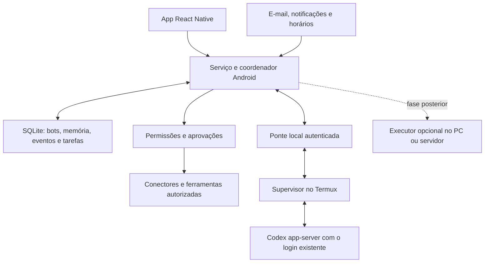

**MyBots — plano para uma plataforma de bots pessoais com ferramentas e rotinas**

Pesquisa e inspeção do projeto: **19/10/2026**. Este documento é um plano de desenvolvimento. Capacidades propostas abaixo ainda precisam ser implementadas e validadas.

**1. Produto que vamos construir**

Cada bot poderá assumir uma responsabilidade contínua: acompanhar atividades da faculdade, organizar documentos, cuidar de uma agenda, pesquisar oportunidades ou operar um fluxo de trabalho autorizado. A pessoa cria o bot, descreve o resultado esperado, conecta suas contas e escolhe sua autonomia. O bot recebe acontecimentos relevantes, trabalha, mantém memória e apresenta resultados ou pedidos de decisão.

O aplicativo continua em React Native, em português, com fundo claro, verde, boa leitura e uso pelo teclado. O APK próprio é a base para os recursos Android. No modo celular, a inteligência continua usando o Codex já autenticado no Termux. Isso exige internet para as respostas do Codex; independência do PC não significa funcionamento sem internet.

“Conectar em tudo” será uma capacidade de expansão por conectores. Cada integração dependerá do que o serviço oferece e da autorização da conta. O Android isola os dados privados dos apps; uma permissão genérica não abre todas as contas e bancos de dados instalados. [Sandbox do Android](https://source.android.com/docs/security/app-sandbox)

**2. Ponto de partida real do repositório**

| Área | O que foi encontrado | Consequência para o plano |
| --- | --- | --- |
| Interface | `mobile/App.js`, React Native e Expo SDK 57 | Evoluir a interface existente e manter o APK como ambiente principal de teste. |
| Termux | `mobile/modules/termux-bridge/.../TermuxBridgeModule.kt` e `TermuxResultReceiver.kt` | Já existem chamadas de status, modelos e resposta via `RUN_COMMAND`. |
| Conversa | `mobile/local.js` e `lib/codex.mjs` | O prompt limita o bot a conversar; o executor desativa ferramentas, plugins e memória. |
| Sessões | `codex exec --ephemeral`, com envio de até aproximadamente 90 mil caracteres recentes | Acrescentar sessões e memória de trabalho próprias para tarefas longas. |
| Persistência mobile | JSON privado `mybots-local.json`, gravado pelo módulo nativo | Migrar com cópia de segurança para uma base transacional acessível pelo serviço. |
| Persistência do PC | `.data/bots.json`, por meio de `lib/store.mjs` | Preservar os identificadores e os dados existentes nas migrações. |
| Retorno do Termux | Promessas guardadas em memória, resolvidas pelo receiver | Um processo encerrado perde o solicitante; tarefas precisam de registro persistente independente da interface. |
| Segundo plano | Não foi encontrado serviço de plantão nem fila persistente | Essa camada precisa ser construída. Um temporizador em React não resolve o ciclo de vida do Android. |
| Atualizações | Pacote `com.mybots.app`, `versionCode` 6; release configurado com assinatura de debug | Manter compatibilidade de atualização do APK instalado e planejar assinatura de distribuição antes de publicar. |

O usuário confirmou que a conversa via Termux funciona no aparelho. Essa confirmação é evidência do fluxo atual; execução longa, conectores e funcionamento com a tela apagada ainda precisam de testes próprios. O README contém descrições de etapas antigas e deverá ser atualizado conforme as novas entregas.

**3. O que aproveitar da referência Grok Bot**

A documentação atual descreve um computador persistente na nuvem compartilhado pelos bots da conta, com navegador, arquivos e ferramentas conectadas. Isso explica a amplitude das tarefas: os bots têm um ambiente onde efetivamente executar o trabalho. [Computador e apps do Grok Bot](https://docs.x.ai/grok-bot/computer-and-apps)

Outro elemento útil é distinguir uma habilidade, que descreve como fazer algo, de uma rotina, que define quando um bot faz isso. A orientação oficial é tornar a tarefa confiável antes de automatizá-la. [Habilidades e rotinas](https://docs.x.ai/grok-bot/skills-routines-and-automations)

Decisão proposta para o MyBots: compartilhar o catálogo de capacidades e permitir reutilizar conexões, com concessões explícitas por bot. A autorização será verificada no executor de ferramentas. Perfis de navegador compartilhados e processos com acesso amplo ao Termux não oferecem isolamento forte entre bots; esse limite deve aparecer nas configurações avançadas.

Esta é a cobertura de produto pretendida; a coluna de entrega indica a ordem proposta para o MyBots:

| Capacidade | Experiência pretendida | Entrega |
| --- | --- | --- |
| Conversa com execução | Respostas progressivas, ferramentas visíveis, cancelar e continuar uma tarefa | Executor comum. |
| Memória por bot | Preferências e conhecimento consultáveis e corrigíveis | Base inicial; aprimoramento com uso real. |
| Apps e múltiplas contas | Conectar uma vez e conceder recursos a bots escolhidos | E-mail primeiro; catálogo expansível depois. |
| Responsabilidades e rotinas | Pedir uma função duradoura pelo chat e revisar quando ela deve agir | Faculdade e Plantão. |
| Arquivos e resultados | Anexar documentos, gerar notas/arquivos, visualizar e compartilhar resultados | Base de artefatos no executor; leitores e formatos adicionados conforme suporte. |
| Navegador e sessões | Bot opera um site e entrega o controle para login ou decisão | Fase de operação web. |
| Equipe de bots | Conversas em grupo, delegação e acompanhamento de tarefas relacionadas | Após o executor e as concessões estarem confiáveis. |
| Habilidades e modelos de bots | Reutilizar procedimentos e compartilhar uma configuração sem dados privados | Fase de habilidades e equipe. |
| Ensinar por demonstração | Gravar um fluxo autorizado, gerar habilidade e testar antes de repetir | Depois do navegador, com credenciais fora da gravação. |
| Voz e imagens | Ditado e anexos de imagem quando a plataforma/modelo suportarem | Melhoria posterior; verificar suporte real sem pressupor outra API paga. |
| Trabalho independente do aparelho | Servidor continua rotinas mesmo com celular desligado | Modalidade opcional final. |

Voz, novos formatos de arquivo e demonstração são frentes planejadas. Não são pré-requisitos para o bot da faculdade nem justificam atrasar o primeiro fluxo útil.

**4. Arquitetura recomendada**

**Aplicativo e serviço Android.** A interface configura bots, acompanha trabalho e recebe decisões. O coordenador nativo controla a fila, o agendamento, as conexões e as notificações. Ele pode funcionar sem depender de uma tela React montada. Uma base Room sobre SQLite será a fonte de verdade do APK, acessada pela interface por meio do módulo nativo.

**Supervisor no Termux.** A chamada atual retorna o resultado de um comando; ela precisa evoluir para uma sessão de comunicação que acompanhe ferramentas, interrupção e progresso. A proposta é iniciar pelo `RUN_COMMAND` um pequeno supervisor que controla o Codex por `stdio`. Ele oferece ao APK somente operações de trabalho autorizadas por uma conexão em `127.0.0.1`, protegida por segredo de sessão. A interface não recebe um terminal remoto nem as credenciais do Codex. Outros apps também podem alcançar portas locais, portanto autenticação é obrigatória.

Esse supervisor é uma hipótese técnica que deve passar por uma prova no POCO antes de consolidar a arquitetura. A instalação deve descobrir o ambiente que hoje resolve o comando `codex`; não presumir um caminho fixo para Node. Se precisar de um runtime adicional, o aplicativo conduz uma preparação inicial e verifica o resultado. Não deve exigir comandos manuais no celular a cada uso. A ponte respeita as permissões e os limites de transporte documentados pelo Termux. [RUN_COMMAND](https://github.com/termux/termux-app/wiki/RUN_COMMAND-Intent)

**Codex.** Usar `app-server` como candidato principal para sessões, progresso, cancelamento e chamadas de ferramentas. Gerar o esquema do protocolo na versão efetivamente instalada e verificar sua compatibilidade. `dynamicTools` é experimental: experimentar ferramentas controladas pelo aplicativo e manter MCP local como alternativa a avaliar. Preservar o catálogo dinâmico e enviar modelo e raciocínio explicitamente em cada turno. [App Server](https://learn.chatgpt.com/docs/app-server) · [MCP no Codex](https://learn.chatgpt.com/docs/extend/mcp?surface=cli)

**Ferramentas.** Operações como ler e-mail ou criar uma pendência são executadas por conectores tipados, depois de validar a permissão. O modelo recebe descrições e resultados necessários, sem receber tokens. Isso permite criar novos bots usando capacidades existentes, sem desenvolver um executor diferente para cada bot.

**5. Contrato comum de todos os bots**

Cada bot terá nome, personalidade, responsabilidade, modelo/raciocínio, conexões permitidas, ferramentas disponíveis, regras de autonomia, memória e rotinas. Criar um bot poderá partir de uma frase como: “Cuide das atividades destas disciplinas e avise quando surgir uma entrega”. O aplicativo transforma essa intenção numa configuração revisável, mostrando fonte, ação e frequência.

Esses atributos ampliam o bot existente. Um bot criado apenas para conversa não começa a executar rotinas ou recebe acesso às contas automaticamente quando o aplicativo é atualizado.

| Registro | Informação principal |
| --- | --- |
| Bot | Perfil e responsabilidade; configurações de modelo; estado de ativação. |
| Conexão | Provedor, conta, escopos, referência ao segredo, validade e cursor de sincronização. |
| Concessão | Qual bot pode usar qual ação, conta e recurso. |
| Evento | Origem, identificador externo, versão, data e referência ao conteúdo. |
| Tarefa | Bot responsável, origem, executor, estado, tentativas, prazo e progresso. |
| Rotina | Gatilho, frequência/fuso, habilidade, limites e próxima execução prevista. |
| Memória | Fato ou preferência, origem, data, revisão e escopo de compartilhamento. |
| Aprovação | Ação concreta, destino, parâmetros, validade e decisão da pessoa. |
| Artefato | Nota, arquivo ou resultado estruturado produzido, ligado à tarefa e às fontes. |

A fila começa executando um turno de modelo por vez no celular, priorizando a conversa iniciada pela pessoa. Cada bot tem controle de concorrência. Reinícios recuperam tarefas pelo banco, e eventos repetidos não criam novas tarefas sem necessidade.

Resultados remotos ambíguos exigem reconciliação: se a rede cair depois de criar um evento na agenda, consultar se ele foi criado antes de tentar outra vez. Repetição automática de operações externas não pode depender apenas de “tentar novamente”.

A memória usa fatos e resumos com referências, em vez de depender exclusivamente de um chat crescente. A pessoa pode consultar, corrigir e apagar memórias. Compartilhamento entre bots exige uma concessão; mencionar outro bot não dá acesso automático a sua conversa inteira.

**6. Estratégia para conectar os apps**

Ordem técnica: API oficial quando disponível; MCP compatível para reaproveitar ferramentas; navegador para fluxos sem API; recursos Android para dados que o sistema permite compartilhar. Um conector de ferramentas e um gatilho são capacidades distintas: conseguir buscar mensagens não significa receber eventos de novas mensagens automaticamente. [Arquitetura MCP](https://modelcontextprotocol.io/docs/learn/architecture)

| Integração | Caminho proposto | Limite que precisa estar no produto | Ordem |
| --- | --- | --- | --- |
| Gmail | Autorização Google no Android e Gmail API | Leitura de corpo exige escopo amplo; recorte por remetente é filtro do MyBots. Publicação pode exigir verificação. | Primeira integração, se for a conta usada. |
| Outlook / e-mail institucional Microsoft | OAuth e Microsoft Graph, com sincronização incremental | Conta e organização podem restringir consentimento; validar o acesso ao corpo do e-mail. | Alternativa inicial ao Gmail. |
| SIGAA | E-mail como primeira fonte; verificar API da instituição; navegador quando necessário | A universidade e o endereço ainda são desconhecidos. API da UFRN não comprova acesso ao SIGAA de outra instituição. | Primeiro fluxo de produto; acesso direto depois da investigação. |
| Agenda | API Google Calendar; Graph se a conta for Microsoft | Conceder criação de eventos separadamente da leitura. | Após o fluxo da faculdade. |
| Arquivos locais | Seletor de arquivos/pastas do Android e ferramentas mediadas | Conceder acesso ao recurso selecionado; URI Android não é automaticamente um caminho legível no Termux. | Base para qualquer bot. |
| Drive | Drive API e seleção de recursos | Validar escopos e quais documentos a conta permite acessar. | Expansão do catálogo. |
| Notion | API/MCP com autenticação suportada | A integração só acessa páginas autorizadas; fluxo público e credenciais de servidor exigem desenho próprio. | Expansão do catálogo. |
| GitHub | GitHub App/API e conector compatível | Escolher repositórios e distinguir leitura, comentário e alterações. | Expansão para bots de projeto. |
| Telegram | Bot API com token específico | Um bot não recebe automaticamente o histórico privado da conta pessoal. | Canal de interação opcional. |
| WhatsApp | Avaliar Business Platform para casos comerciais | A plataforma comercial não equivale a acesso geral às conversas do WhatsApp pessoal. | Pesquisa específica antes de prometer suporte. |
| Outros sites | Navegador controlado, com sessão autorizada | Layout, login, CAPTCHA e MFA podem interromper o fluxo. | Fase de operação web. |
| Notificações Android | NotificationListenerService com acesso especial | São sinais parciais; não representam o histórico completo do app nem garantem o corpo de um e-mail. | Gatilho complementar. |

Fontes das famílias: [Gmail e escopos](https://developers.google.com/workspace/gmail/api/auth/scopes), [Microsoft Graph](https://learn.microsoft.com/en-us/graph/delta-query-messages), [API da UFRN](https://api.ufrn.br/), [Calendar](https://developers.google.com/workspace/calendar/api/guides/overview), [Drive](https://developers.google.com/workspace/drive/api/guides/about-sdk), [Notion](https://developers.notion.com/guides/get-started/authorization), [GitHub Apps](https://docs.github.com/en/apps/overview), [Telegram](https://core.telegram.org/bots/faq) e [WhatsApp Business Platform](https://whatsappbusiness.com/products/business-platform/).

O catálogo precisa dizer o que cada conexão pode fazer: ler, pesquisar, receber eventos, criar rascunhos, alterar ou enviar. Também deve indicar onde executa e se precisa de serviço remoto. Autenticar uma conta não instala automaticamente todos os recursos possíveis dela.

Conectar uma conta deve permitir reutilizá-la em vários bots, escolhendo quais recebem acesso. A pessoa poderá revogar uma conexão e pausar imediatamente as rotinas que dependem dela.

**7. Autenticação e dados dos conectores**

Para Google no Android, usar o fluxo de autorização indicado para a plataforma. Não embutir segredos de um cliente confidencial no APK nem adaptar por conta própria o callback de um cliente desktop. Registrar o projeto OAuth, o pacote e o certificado aplicável faz parte da entrega. [Autorização Google no Android](https://developer.android.com/identity/authorization)

`gmail.readonly` permite ler a caixa de e-mail e é classificado como restrito. Selecionar mensagens do SIGAA dentro do MyBots não reduz o escopo concedido pelo Google. Avaliar as exigências de verificação e de tratamento/transmissão desses dados ao Codex antes de distribuir publicamente. O teste pessoal e a publicação para outros usuários são marcos diferentes. [Escopos e verificação Gmail](https://developers.google.com/workspace/gmail/api/auth/scopes)

No celular, começar com sincronização incremental periódica e recuperação de mudanças perdidas. O push oficial do Gmail usa Cloud Pub/Sub, exige configuração própria e renovação de `watch`; não aparece apenas por habilitar notificações no Android. Um servidor opcional poderá recebê-lo mais tarde. [Push Gmail e recomendação para clientes instalados](https://developers.google.com/workspace/gmail/api/guides/push)

Tokens ficam em armazenamento privado protegido por chaves do Android Keystore, com política de backup e renovação. O modelo recebe o conteúdo necessário à tarefa após os filtros. Antes de conectar, a pessoa entende que os trechos selecionados serão processados pelo Codex. Revogação, expiração e bloqueio administrativo produzem um estado claro de “reconectar conta”.

**8. Funcionamento com a tela apagada**

Implementar um modo Plantão ativado pela pessoa, com serviço nativo e notificação de estado e pausa. Ele acompanha eventos e executa trabalho quando necessário. O serviço do MyBots e o processo do Termux são componentes distintos: ambos precisam de diagnóstico e recuperação. Excluir só o MyBots da economia de bateria não garante a permanência do Termux.

Para o serviço, declarar o tipo que corresponda ao uso real. Avaliar `specialUse` apenas se a função se enquadrar e documentar o subtipo. Para distribuição pela Play Store, isso precisa de revisão; não é uma autorização genérica para qualquer execução. [Tipos de foreground service](https://developer.android.com/develop/background-work/services/fgs/service-types)

Corrigindo uma expectativa importante: notificação persistente e autorização de bateria não garantem 24 horas de execução contínua. Serviços `dataSync` e `mediaProcessing` têm limite de seis horas de segundo plano em 24 horas a partir do Android 15 nas condições documentadas. O WorkManager periódico tem mínimo de 15 minutos e não garante o minuto exato. [Limites de serviços](https://developer.android.com/develop/background-work/services/fgs/timeout) · [Agendamento periódico](https://developer.android.com/develop/background-work/background-tasks/persistent/getting-started/define-work)

Usar eventos e sincronizações curtas, manter a fila persistente e reservar wake locks para trabalho que realmente precise deles. Solicitar os ajustes de bateria apropriados para MyBots e Termux e medir no POCO. Doze e encerramentos devem ser tratados como estados de execução, com retomada e indicação de atraso. [Doze e economia de bateria](https://developer.android.com/training/monitoring-device-state/doze-standby)

O painel informa última consulta bem-sucedida, próximo trabalho previsto, origem e executor. Se o celular passou horas suspenso, a pessoa verá “atualização atrasada”, não uma indicação verde baseada apenas na existência do serviço. Depois de encerramento forçado ou reinício, pode ser necessária uma ação da pessoa para reativar componentes; isso entra no teste real. [Limites relatados por mantenedor do Termux](https://github.com/termux/termux-app/issues/4657)

Para tarefas que precisam continuar mesmo com o celular desligado, será necessário um executor independente no PC ligado ou num servidor. Essa é uma modalidade futura, com configuração, autenticação e custo próprios.

**9. Primeiro fluxo completo: bot da faculdade**

O caso da faculdade valida a plataforma de forma concreta. A lógica acadêmica fica numa habilidade e em dados de atividades; o mecanismo de conectores, fila e rotinas serve aos outros bots.

1. A pessoa conecta o provedor de e-mail e seleciona os remetentes, disciplinas ou termos relevantes.
2. O sincronizador coleta mudanças e registra cada mensagem pela conta e pelo identificador do provedor.
3. O bot classifica aviso, atividade, alteração de prazo ou cancelamento e extrai dados estruturados com referência à fonte.
4. A atividade guarda disciplina, título, instruções, prazo, fuso, link, fonte e estado de confirmação. Prazo ausente fica desconhecido; data sem horário não vira automaticamente 23h59.
5. Reenvios e revisões são reconciliados. Se existir identificador da atividade no SIGAA, ele ajuda a unir as fontes; coincidência de título não basta para juntar tudo automaticamente.
6. A pessoa acompanha hoje, semana e atrasadas; corrige dados e marca conclusão.
7. O bot emite alertas conforme regras configuradas e registra o motivo de cada aviso. Alterar a agenda externa depende da concessão apropriada.
8. Quando o e-mail estiver incompleto, apresenta “consultar SIGAA” e a informação faltante. O acesso direto será integrado após identificar a instituição e validar o caminho disponível.

Critério de conclusão: receber uma atividade real, registrá-la com fonte, preservar após fechar/reabrir, aplicar uma alteração de prazo sem duplicar e notificar segundo a regra. Esse fluxo precisa continuar recuperável após uma interrupção de rede ou processo.

**10. Operar sites e apps sem API**

Uma camada de navegador aumenta bastante a cobertura. Ela precisa de sessão persistente, leitura da página, ações controladas, arquivos e transferência temporária de controle para login/MFA. O navegador auxiliar é uma ferramenta do agente dentro de um produto com interface nativa.

No PC ou num executor Linux compatível, avaliar Playwright/Chromium com perfil dedicado. Como o PC usa Arch, validar o ambiente ou usar um contêiner de distribuição suportada. No celular, fazer uma prova separada com navegador próprio ou automação compatível; não presumir que instalar Playwright no Termux reproduz um navegador desktop. A documentação classifica o suporte Android como experimental, com dependência de ADB e limitações. [Playwright Android](https://playwright.dev/docs/api/class-android) · [Requisitos de ambiente](https://playwright.dev/docs/next/intro)

Se a prova de navegador local não atender ao fluxo, antecipar o pareamento seguro de um executor do PC para essa capacidade. Nesse caso, “Só celular” continua atendendo às ferramentas locais e por API; a tarefa que precisa do navegador indisponível mostra essa dependência. Sessões e tarefas não migram silenciosamente de um dispositivo para outro.

Login no Chrome pessoal não dá automaticamente acesso às mesmas sessões num navegador do MyBots. A pessoa faz login no ambiente correto. CAPTCHA e MFA interrompem a tarefa e pedem intervenção, com retomada posterior. Cada fluxo precisa de evidência do resultado e detecção de mudança de layout.

Controle amplo de outros apps Android pela tela será tratado como projeto experimental separado. A política atual da Play Store proíbe usar Acessibilidade para apps que iniciam, planejam e executam decisões autonomamente, salvo a exceção prevista para ferramentas de acessibilidade. APK pessoal e publicação na loja têm condições diferentes. Não basear a cobertura geral do produto nessa API. [Política de Acessibilidade](https://support.google.com/googleplay/android-developer/answer/10964491?hl=en)

O acesso a notificações também é limitado: há proteção de conteúdo sensível, incluindo códigos de uso único. Esse mecanismo não substitui autenticação nem dá leitura completa de contas. [Proteções Android](https://developer.android.com/about/versions/15/behavior-changes-all)

**11. Etapas de entrega e critérios de aceite**

| Etapa | Entrega | Conclui quando |
| --- | --- | --- |
| 0 — Preservação e provas | Backup/exportação, migração planejada, compatibilidade da assinatura, prova do app-server e comunicação com Termux | O APK atual pode receber atualização preservando dados; o supervisor recebe uma tarefa, transmite progresso e cancela; versão e capacidades são registradas. |
| 1 — Executor comum | SQLite, fila persistente, estados, memória inicial, limites e ferramentas locais mediadas | Dois bots usam a mesma ferramenta com permissões diferentes; reiniciar recupera uma tarefa sem perder dados; cancelamento encerra o trabalho real. |
| 2 — Conexões | Registro de ferramentas, conta OAuth do provedor usado, renovação/revogação e sincronização incremental | A conta real conecta, busca mensagens, retoma pelo cursor e apresenta falhas de autenticação corretamente. |
| 3 — Faculdade | Habilidade acadêmica, atividades, fontes, deduplicação e tratamento de revisões | O fluxo real descrito na seção 9 passa no celular, inicialmente disparado manualmente. |
| 4 — Plantão | Serviço nativo, rotinas/eventos, notificação persistente, recuperação e diagnóstico de energia | Testes com tela apagada e Doze demonstram o comportamento e os atrasos; o painel registra interrupções e retomadas. |
| 5 — Catálogo expansível | Agenda, arquivos, um serviço de produtividade e cliente MCP com operações revisadas | Um novo bot usa as mesmas conexões e ferramentas sem alteração do executor central; revogar uma concessão bloqueia a chamada. |
| 6 — Trabalho em sites | Navegador e executor compatível, incluindo pareamento seguro com PC se necessário; primeira integração SIGAA direta se viável | Fluxo autenticado real funciona, pede ajuda em login/MFA e reconhece falha de página sem inventar conclusão. |
| 7 — Habilidades e equipe | Salvar procedimentos, propor rotinas pelo chat, grupos, delegação, modelos de bots e demonstração de fluxos | Uma tarefa pode ser repassada com contexto limitado; limites impedem ciclos; uma habilidade ensinada é revisada/testada; um modelo exportado não leva segredos ou histórico privado. |
| 8 — Execução ampliada | PC opcional; depois servidor para tarefas independentes do celular | Cada tarefa tem executor e dono claros; perda de conexão não causa execução duplicada nem transferência silenciosa de credenciais. |

As etapas 0 a 4 formam o primeiro produto útil e geral com o bot da faculdade. As etapas 5 a 8 ampliam a cobertura até a experiência de bots que operam vários serviços. A execução por ferramentas começa cedo; capacidade universal de controlar qualquer interface não é pressuposto dessas primeiras entregas.

As provas de protocolo, permanência em segundo plano e acesso ao SIGAA determinam a estimativa de prazo. O plano não depende de prometer uma data antes de verificar esses pontos.

**12. Experiência no aplicativo**

Navegação principal: **Bots**, **Atividade**, **Conexões** e **Configurações**. Cada bot oferece conversa e acesso a sua responsabilidade, memória, rotinas e permissões. Resultados estruturados, como atividades acadêmicas, aparecem em cartões com fonte e ações úteis.

O fluxo principal será: criar bot → dizer a responsabilidade → conectar o serviço necessário → revisar a regra → executar uma vez → ativar a rotina. Conexões faltantes aparecem como ações de configuração, sem exigir que a pessoa conheça termos como JSON-RPC ou MCP.

Estados visíveis: aguardando evento, na fila, trabalhando, aguardando aprovação, precisa de login, sem rede, limite atingido, suspenso pelo aparelho, falhou, cancelado e concluído. O indicador “Celular” ou “Computador” identifica onde a tarefa realmente está executando.

Aprovações mostram destino e efeito concretos. Leituras e atualizações internas podem ter regras persistentes já autorizadas; ações externas seguem as regras escolhidas para aquela ferramenta e recurso. Uma regra ampla na personalidade não altera permissões técnicas.

O registro da resposta diferencia modelo/raciocínio solicitado e metadados confirmados pelo runtime, quando disponíveis. Dados desconhecidos não serão apresentados como confirmação. Respostas antigas sem metadados continuam com “Modelo não registrado”.

**13. Segurança, recursos e confiabilidade**

O executor valida bot, conta, ação e recurso em cada chamada. E-mails, páginas e resultados de ferramentas são conteúdo externo: não podem conceder acesso nem alterar as regras do bot. Uma aprovação se vincula aos parâmetros da ação e perde validade se eles mudarem. Esse controle é código, além das instruções dadas ao modelo. A própria documentação do Grok Bot descreve revisão por modelo como complemento às permissões. [Aprovações e limites](https://docs.x.ai/grok-bot/approvals-security-and-privacy)

O bot responsável e a conta vêm do contexto autenticado da tarefa. Um argumento de ferramenta escolhido pelo modelo não pode trocar essa identidade. Para navegador, escolher perfis por conjunto de contas e nível de confiança; um perfil compartilhado concede acesso mais amplo do que uma ferramenta de API com recursos delimitados.

O caminho padrão usa ferramentas mediadas, com shell amplo desativado. Habilitar comandos genéricos no mesmo ambiente Termux pode alcançar arquivos e credenciais desse ambiente; diretórios distintos de bots não criam isolamento de sistema operacional. Tarefas de shell amplo exigem um modo de confiança específico ou um executor isolado apropriado.

Instalação de MCPs e extensões exige verificar origem, versão, dependências, permissões e destino dos dados. MCP padroniza a conexão, mas não torna automaticamente um serviço seguro ou compatível com o Android. Provedores que exigem segredo confidencial de aplicação podem precisar de intermediário; não embutir esse segredo num APK distribuído.

Cada rotina tem frequência, limite de passos/tentativas e janela de trabalho. Conversa humana tem prioridade. Ausência de mudanças é resolvida sem chamar o modelo. Usar contexto selecionado e resumos para controlar consumo. Uso e limites só aparecem quando o runtime os informar; a assinatura atual pode limitar o trabalho e não garante execução ilimitada. Evitar estimativas de custo baseadas numa lista fixa de modelos.

Na execução ampliada, uma tarefa tem um único dono e uma concessão de execução com validade. No começo, o celular coordena seus trabalhos e o PC recebe tarefas pareadas. Para rotinas independentes do aparelho, o servidor passa a coordenar explicitamente aquelas rotinas; duas instâncias não devem agendá-las como se ambas fossem a principal. Credenciais são autorizadas no ambiente correspondente, sem copiar automaticamente o login do Codex do celular.

Logs usam identificadores de tarefas e ocultam segredos; corpo de e-mail não entra por padrão em diagnósticos compartilháveis. Exportação de dados tem formato versionado e não leva credenciais por padrão. A migração da assinatura atual de teste para distribuição precisa de estratégia própria para preservar dados; não orientar reinstalação como solução automática.

**14. Verificação necessária em cada entrega**

| Situação | Evidência esperada |
| --- | --- |
| Atualização/migração | Bots, mensagens, identificadores e metadados preservados; restauração de backup exercitada. |
| Permissões por bot | Uma chamada sem concessão é negada no executor, mesmo se o modelo tentar. |
| Evento repetido | Uma atividade e um resultado, com tentativas rastreáveis. |
| Prazo alterado ou ausente | Revisão aplicada com fonte; informação desconhecida não é inventada. |
| E-mail com instrução maliciosa | Conteúdo não muda concessões nem aciona ferramentas fora da tarefa. |
| OAuth expirado/revogado | Renovação suportada ou pedido claro de reconexão; sem expor tokens. |
| Rede interrompida | Fila preservada, retomada por cursor e tratamento de ação remota com resultado incerto. |
| Cancelamento/limite | Processo interrompido ou estado pendente explicado; sem execução silenciosa interminável. |
| Tela apagada/Doze | Horários de evento e execução registrados; medir atraso, energia e temperatura no POCO. |
| MyBots ou Termux encerrado | Trabalho incompleto registrado e retomada controlada, sem depender de uma Promise antiga. |
| Reinício do aparelho | Comportamento após primeiro desbloqueio documentado; apresentar ação necessária quando houver. |
| Mais de um bot | Fila e prioridades respeitadas; ausência de vazamento de memória ou credenciais entre concessões. |
| Fluxo web alterado | Falha explícita e pedido de intervenção; nenhuma confirmação baseada só no texto do modelo. |

Testes de fila, permissões, migração e deduplicação serão automatizados na implementação. Conectores reais exigem contas de teste e ações controladas. Segundo plano, bateria e Termux exigem o aparelho físico. A estabilidade deve ser medida em janelas progressivas, incluindo uma sessão prolongada; compilar um APK não comprova permanência por 24 horas.

O uso de módulos nativos exige construir o próprio aplicativo; Expo Go não recebe código nativo adicional. [Customização nativa do Expo](https://docs.expo.dev/workflow/customizing/)

**15. Próximo bloco de trabalho e decisões pendentes**

O primeiro bloco reúne as etapas 0 e 1: preservar dados, provar o protocolo do Codex no Termux, construir a comunicação autenticada, registrar tarefas de forma persistente e validar uma ferramenta mediada com duas concessões diferentes. Isso produz a base que todos os bots usarão.

Em seguida, implementar o provedor de e-mail realmente utilizado e o fluxo da faculdade. Só depois de uma execução real correta ativar o plantão para esse fluxo. Agendas, arquivos, MCPs e outros serviços entram pelo mesmo contrato.

Informações a obter durante a implementação, sem bloquear este plano: instituição e URL do SIGAA; provedor da conta de e-mail; um aviso acadêmico representativo; regras desejadas de alerta; prioridade dos próximos serviços; intenção de manter APK pessoal ou distribuir pela loja. O acesso a essas contas será autorizado pela interface apropriada, não pelo envio de senhas na conversa.

O que foi validado neste planejamento: estrutura e caminhos atuais do código e documentação oficial dos componentes citados. Integrações autenticadas, supervisor persistente, automação web e consumo de bateria ainda são propostas a comprovar nas respectivas etapas.
